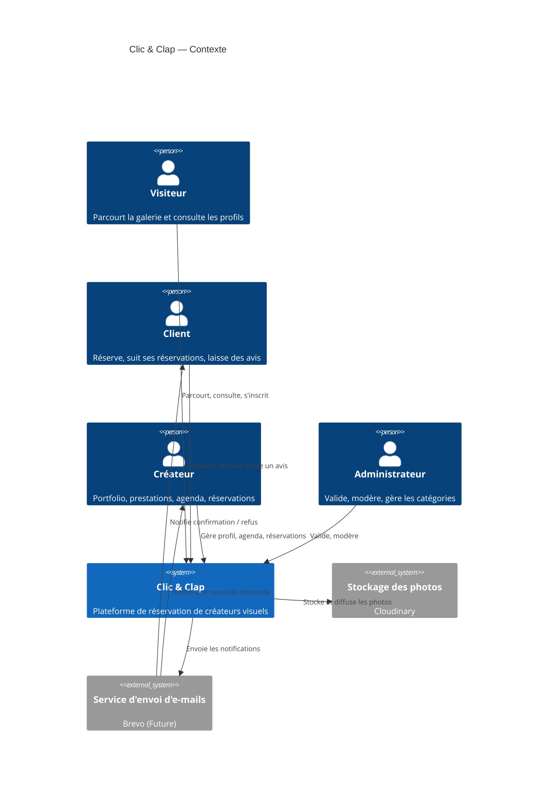
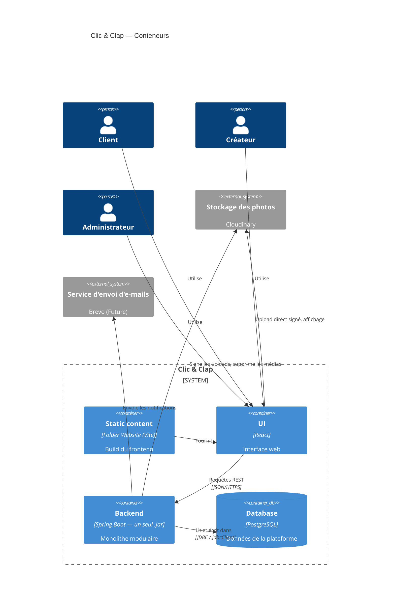

# Architecture — monolithe modulaire et modèle C4 (IcePanel)

Projet **Clic & Clap** — Derouck Arredondo Francisco Homero · Dassi Kouam Gedeon
Version 1.3 — Octobre 2026

## Choix d'architecture

Clic & Clap est un **monolithe modulaire** : un seul projet Spring Boot, compilé en un seul `.jar`, déployé comme un seul processus et connecté à une seule base PostgreSQL. Le code est découpé par **domaine métier** (modules `users`, `creators`, `offerings`, `bookings`, `reputation`, `moderation`, `catalog`, `admin`, `notifications`).

Conventions **Spring Modulith** (cours, chapitre 5) :

- chaque module est un **sous-package direct** du package principal (ex. `be.heh.clicetclap.bookings`) ;
- les types placés **à la racine** du module forment son API (façade `BookingApi`, records, événements comme `BookingConfirmed`) ;
- tout le reste (contrôleur, service, repository `JdbcClient`) va dans le sous-package **`internal`** et reste invisible pour les autres modules ;
- les dépendances entre modules forment un **graphe sans cycle** ;
- les modules communiquent **de préférence par événements** (`ApplicationEventPublisher.publishEvent` + `@ApplicationModuleListener`), et par appel direct de l'API publique seulement quand une réponse immédiate est nécessaire (ex. vérifier qu'un créneau est libre) ;
- la structure est vérifiée par un test `ApplicationModules.of(ClicEtClapApplication.class).verify()` (cycles + visibilité).

Les diagrammes officiels sont réalisés dans **IcePanel** (outil imposé), en reprenant les conventions de l'exemple **PubNotify** fourni par l'enseignant. Ce document sert de référence pour les saisir ; les blocs Mermaid ne sont qu'un aperçu lisible sur GitHub.

**Diagrammes IcePanel** : [https://s.icepanel.io/LhJJxAELCMfdkx/YeYM](https://s.icepanel.io/LhJJxAELCMfdkx/YeYM)
Fichier d'import et instructions : [docs/icepanel/README.md](icepanel/README.md).

| Niveau | Diagramme | Question à laquelle il répond |
|--------|-----------|-------------------------------|
| 1 | Contexte | Qui utilise Clic & Clap et avec quels systèmes externes communique-t-il ? |
| 2 | Conteneurs | De quelles applications et bases de données le système est-il composé ? (on y voit le monolithe : une seule boîte backend) |
| 3 | Modules du monolithe | Quels modules composent le monolithe et qui appelle qui ? |
| 4 | Code (facultatif) | Quelles classes composent le module `bookings` ? |
| — | Déploiement | Sur quoi chaque conteneur tourne-t-il (local et en ligne) ? |

**Conventions reprises de PubNotify**

- Chaque acteur porte une courte description sous son nom.
- **Statut IcePanel** : `Live` pour ce qui est prévu dans le cahier des charges, `Future` (petit cercle violet pointillé dans l'exemple) pour ce qui n'est pas encore validé — ici le service d'e-mails et le fournisseur d'identité, avec leurs flèches.
- Composants du niveau 3 : technologie `Component: Spring Framework`, conteneur Backend `App: Spring Boot`.
- Les systèmes externes indiquent leur technologie : `External system: <techno>`.
- Les Apps et Stores indiquent leur technologie : `App: React`, `Store: PostgreSQL`.
- Les flèches portent un verbe court en français.

> Les points marqués **(à confirmer)** ne sont pas encore décidés dans le cahier des charges.

---

## Niveau 1 — Contexte

### Éléments

| Nom | Type IcePanel | Description / technologie |
|-----|---------------|---------------------------|
| Visiteur | Actor | Parcourt la galerie, filtre les créateurs et consulte leurs profils |
| Client | Actor | Réserve une ou plusieurs prestations, suit ses réservations et laisse des avis |
| Créateur | Actor | Présente son portfolio, définit ses prestations et son agenda, traite les réservations |
| Administrateur | Actor | Valide les créateurs, modère les signalements et gère les catégories |
| Clic & Clap | System | Plateforme web de réservation de photographes et vidéastes |
| Stockage des photos | External system | `External system: Cloudinary` |
| Service d'envoi d'e-mails | External system | `External system: Brevo` — statut **Future** **(à confirmer)** |
| Fournisseur d'identité | External system | `External system: Google (OAuth2)` — statut **Future** **(Bonus, à confirmer avec l'enseignant)** |

### Relations

| De | Vers | Libellé |
|----|------|---------|
| Visiteur | Clic & Clap | Parcourt, consulte les profils, s'inscrit |
| Client | Clic & Clap | Réserve, annule, laisse un avis, signale |
| Créateur | Clic & Clap | Gère son profil, son agenda et ses réservations |
| Administrateur | Clic & Clap | Valide, modère, gère les catégories |
| Clic & Clap | Stockage des photos | Stocke et diffuse les photos des portfolios |
| Clic & Clap | Service d'envoi d'e-mails | Envoie les notifications de réservation |
| Service d'envoi d'e-mails | Créateur | Notifie une nouvelle demande |
| Service d'envoi d'e-mails | Client | Notifie la confirmation, le refus ou l'expiration |
| Clic & Clap | Fournisseur d'identité | Authentifie l'utilisateur **(si OAuth2 validé)** |

> Capture IcePanel : 

---

## Niveau 2 — Conteneurs

Zoom sur la boîte **Clic & Clap**. Il n'y a **qu'une seule boîte backend** : c'est ce qui montre que l'application est un monolithe.

### Éléments à l'intérieur de Clic & Clap

| Nom | Type IcePanel | Technologie | Description |
|-----|---------------|-------------|-------------|
| Static content | App | `App: Folder Website` (build Vite) | Fichiers HTML/JS/CSS du frontend après build |
| UI | App | `App: React` | Interface web exécutée dans le navigateur |
| Backend | App | `App: Spring Boot` | **Monolithe modulaire** (un seul `.jar`) : API REST, sécurité, tâches planifiées |
| Database | Store | `Store: PostgreSQL` | Utilisateurs, profils, albums, prestations, créneaux, réservations, avis, signalements |

### Relations

| De | Vers | Libellé |
|----|------|---------|
| Acteurs | Static content | Charge l'interface utilisateur à partir de |
| Static content | UI | Fournit |
| Acteurs | UI | Utilise |
| UI | Backend | Envoie des requêtes REST (JSON / HTTPS) |
| Backend | Database | Lit et écrit dans (JDBC — `JdbcClient`) |
| UI | Stockage des photos | Envoie les photos (upload direct signé) et les affiche |
| Backend | Stockage des photos | Signe les uploads, supprime les médias |
| Backend | Service d'envoi d'e-mails | Envoie les notifications (statut Future) |

> **Choix retenu** : upload direct depuis l'UI vers Cloudinary avec une signature générée par le Backend ; le Backend garde l'accès à Cloudinary pour supprimer un média (créateur ou modération).

> Capture IcePanel : 

---

## Niveau 3 — Modules du monolithe

Zoom sur la boîte **Backend** (`App: Spring Boot`), comme le niveau 3 « Publishing / Notifications » du cours. Chaque **module** est un composant (`Component: Spring Framework`). Une flèche entre modules est soit un **appel de l'API publique**, soit un **`publishEvent`** (libellé de flèche repris du cours).

### Modules

| Module | Responsabilités | API publique |
|--------|-----------------|--------------|
| users | Inscription, connexion, rôles (client / créateur / admin), suspension | `UserApi` |
| creators | Profil créateur (bio, ville, pays, zones, spécialités), validation, albums et photos, galerie publique et filtres | `CreatorApi` |
| offerings | Catégories de prestation, prestations à prix fixe, options payantes, agenda (créneaux, préavis, marge) | `OfferingApi` |
| bookings | Réservation simple et pack, total et promo 5 % / 10 %, anti-collision, atomicité, statuts, annulation tardive, journal des statuts, expiration à 7 jours (`@Scheduled`) | `BookingApi` |
| reputation | Avis et notes (30 jours, un par prestation), badges Nouveau / Top créateur / Réponse rapide | `ReputationApi` |
| moderation | Signalements d'avis et de médias, traitement (suppression ou levée) | `ModerationApi` |
| catalog | Galerie publique, filtres, profil public d'un créateur, statistiques de la page d'accueil — module lecture seule qui agrège `creators`, `offerings` et `reputation` | — (n'expose rien vers les autres modules ; personne ne dépend de lui) |
| admin | Back-office : validation des créateurs, catégories, suspension, statistiques | — (n'est appelé par personne) |
| notifications | Écoute les événements de réservation et envoie les e-mails **(Future)** | — (n'expose rien : il écoute seulement) |

### Relations entre modules

| De | Vers | Libellé |
|----|------|---------|
| UI | chaque module | Requêtes REST vers ses contrôleurs |
| creators | users | Vérifie le compte et le rôle |
| creators | Stockage des photos | Signe les uploads, supprime les médias |
| offerings | creators | Vérifie que le créateur est validé et actif |
| bookings | offerings | Vérifie la disponibilité, récupère prix et options |
| bookings | users | Vérifie le client (pas de réservation de ses propres prestations) |
| bookings | notifications | `publishEvent` : `BookingRequested`, `BookingConfirmed`, `BookingRefused`, `BookingExpired` |
| catalog | creators | Lit les profils actifs et les albums |
| catalog | offerings | Lit les prestations et catégories |
| catalog | reputation | Lit les avis et la note moyenne |
| catalog | bookings | Lit le nombre de prestations terminées (statistiques d'accueil) |
| reputation | bookings | Vérifie que la prestation est terminée ; récupère délais de réponse et prestations terminées |
| moderation | reputation | Supprime un avis signalé |
| moderation | creators | Supprime un média signalé |
| admin | users / creators / offerings / bookings / moderation | Valide, suspend, gère les catégories, consulte les statistiques |
| notifications | users | Récupère l'adresse e-mail du destinataire |
| notifications | Service d'envoi d'e-mails | Envoie un e-mail |
| chaque module | Database | Lit et écrit dans (`JdbcClient`) |

> Le graphe de dépendances est **sans cycle** : `users` ← `creators` ← `offerings` ← `bookings` ← `reputation` ← `moderation`, avec `admin` tout en haut. `catalog` dépend de `creators`, `offerings`, `reputation` et `bookings` ; aucun autre module ne dépend de `catalog`. `notifications` dépend de `bookings` (il écoute ses événements) et de `users` (pour l'e-mail) ; `bookings` ne connaît pas `notifications`.

> Capture IcePanel : 

---

## Niveau 4 — Code du module `bookings` (facultatif)

Le cours présente le niveau 4 comme un diagramme de classes UML, généré depuis l'IDE (IntelliJ) une fois le code écrit. On ne le fait que pour le module le plus riche. En attendant, voici les classes prévues ; dans IcePanel, on peut les montrer en Groups `Controller` / `Service` / `Repository` comme dans l'exemple PubNotify en couches.

| Group | Composant | Rôle |
|-------|-----------|------|
| Controller | BookingController | Créer (simple ou pack), annuler, confirmer, refuser, marquer terminée, lister |
| Service | BookingService | Statuts, anti-collision, atomicité du pack, promo, annulation tardive |
| API (racine du module) | BookingApi | Porte d'entrée publique utilisée par `reputation` et `admin` |
| API (racine du module) | BookingConfirmed, BookingRequested… | Événements publiés (records) |
| Scheduler | ExpirationScheduler | Passe en « Expirée » les demandes sans réponse depuis 7 jours et libère le créneau |
| Repository | JdbcBookingRepository | Réservations et lignes de pack |
| Repository | JdbcStatusHistoryRepository | Journal des changements de statut |

| De | Vers | Libellé |
|----|------|---------|
| UI | BookingController | Requêtes pour réserver et suivre |
| BookingController | BookingService | Délègue la logique métier |
| ExpirationScheduler | BookingService | Expire les demandes de plus de 7 jours |
| BookingService | OfferingApi (module offerings) | Vérifie le créneau, récupère le prix |
| BookingService | module notifications | `publishEvent` (BookingConfirmed…) |
| BookingService | JdbcBookingRepository | Lit et écrit les réservations |
| BookingService | JdbcStatusHistoryRepository | Journalise le changement de statut |
| Repositories | Database | Lit et écrit dans |

> Les noms de classes sont une **proposition** à aligner sur le code réel.

---

## Déploiement (hors C4 du cours — complément)

Sur le modèle du diagramme « Developer laptop » de PubNotify. En local, la base est lancée automatiquement par `spring-boot-docker-compose` (dépendance `developmentOnly`) à partir du `compose.yaml` à la racine du projet.

### Environnement local (développement)

| Group (environnement) | Contient | Détail |
|-----------------------|----------|--------|
| Developer laptop → OS du poste | tout ce qui suit | Windows 11 (Francisco) — OS Gedeon à confirmer |
| Serveur web — `Group: Vite.js` | Static content | `npm run dev` — Node.js 22.13.1 |
| Navigateur web — `Group: Chrome` | UI | React exécuté dans le navigateur |
| Java Virtual Machine — `Group: Java` | Backend | le `.jar` Spring Boot (Gradle) — OpenJDK Temurin 25.0.4.1 |
| Docker (`compose.yaml`) | Database | image `postgres:18` (à confirmer à la création du `compose.yaml`) — Docker 29.8.0 |
| (hors laptop) | Stockage des photos, Service d'envoi d'e-mails | services SaaS |

### Environnement en ligne (production) — (à confirmer)

| Group | Contient |
|-------|----------|
| Hébergeur frontend (à choisir) | Static content |
| Hébergeur backend — conteneur Docker | Backend (un seul `.jar`) |
| PostgreSQL managé ou conteneur Docker | Database |

---

## Journal des modifications

| Date | Version | Modification | Raison |
|------|---------|--------------|--------|
| 2026-10-05 | v1.3 | Ajout du module **`catalog`** (lecture seule : galerie, filtres, profil public, stats d'accueil) ; ajout de la relation `notifications → users` ; versions déploiement renseignées (Temurin 25, Node 22, Docker 29, postgres:18) | Supprime le cycle `creators ↔ offerings` et isole l'assemblage de données publiques dans un module dédié |
| 2026-09-21 | v1.2 | Ajout du diagramme déploiement, choix upload signé Cloudinary, module `notifications` en statut Future | Aligner avec les décisions d'architecture prises en séance |