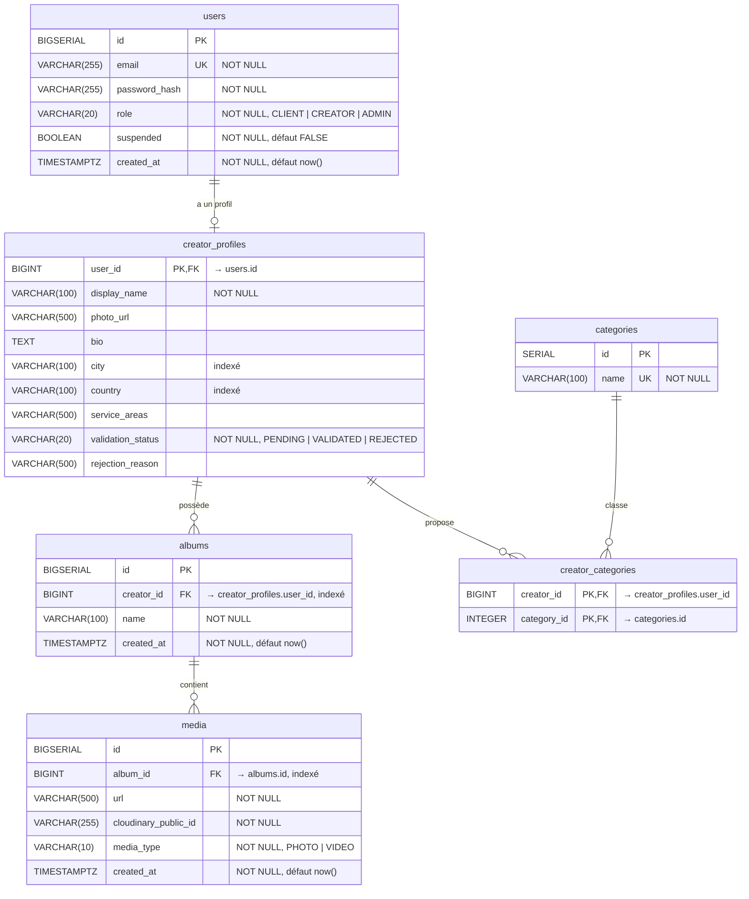

# Schéma physique de la base de données

Projet **Clic & Clap** — version **v0.1 (MVP)**

La base est une **PostgreSQL 17** unique, partagée par tous les modules du monolithe. Les tables sont créées au démarrage de l'application par [`schema.sql`](../../backend/src/main/resources/schema.sql) (`spring.sql.init.mode=always`, instructions `CREATE … IF NOT EXISTS`) et lues ou écrites avec `JdbcClient`, en SQL explicite et paramétré.

Chaque table appartient à **un seul module**. Seul ce module y accède directement ; les autres passent par son API publique.

> Ce schéma décrit exactement `schema.sql`. Il est mis à jour à chaque release qui ajoute ou modifie des tables.

---

## Diagramme

**Légende** : `PK` clé primaire, `FK` clé étrangère, `UK` contrainte d'unicité. `||--o|` : un vers zéro ou un ; `||--o{` : un vers zéro ou plusieurs.

---

## Tables

### `users` — module `users`

Un compte de la plateforme, quel que soit son rôle.

| Colonne | Type | Contraintes |
|---------|------|-------------|
| `id` | `BIGSERIAL` | clé primaire |
| `email` | `VARCHAR(255)` | `NOT NULL`, `UNIQUE` |
| `password_hash` | `VARCHAR(255)` | `NOT NULL` |
| `role` | `VARCHAR(20)` | `NOT NULL`, `CHECK (role IN ('CLIENT', 'CREATOR', 'ADMIN'))` |
| `suspended` | `BOOLEAN` | `NOT NULL`, défaut `FALSE` |
| `created_at` | `TIMESTAMPTZ` | `NOT NULL`, défaut `now()` |

> **À faire dans #10 (authentification Zitadel)** : avec Zitadel, les mots de passe ne sont pas stockés dans notre base. La colonne `password_hash` devra être remplacée par l'identifiant du compte Zitadel (claim `sub` du token).

### `categories` — module `catalog`

Les types de prestation utilisés par les filtres de la galerie (mariage, sport, clip…).

| Colonne | Type | Contraintes |
|---------|------|-------------|
| `id` | `SERIAL` | clé primaire |
| `name` | `VARCHAR(100)` | `NOT NULL`, `UNIQUE` |

### `creator_profiles` — module `creators`

Le profil d'un utilisateur au rôle `CREATOR`. La clé primaire est aussi la clé étrangère vers `users` : un compte a au plus un profil créateur.

| Colonne | Type | Contraintes |
|---------|------|-------------|
| `user_id` | `BIGINT` | clé primaire, `REFERENCES users (id) ON DELETE CASCADE` |
| `display_name` | `VARCHAR(100)` | `NOT NULL` |
| `photo_url` | `VARCHAR(500)` | — |
| `bio` | `TEXT` | — |
| `city` | `VARCHAR(100)` | index `idx_creator_profiles_city` |
| `country` | `VARCHAR(100)` | index `idx_creator_profiles_country` |
| `service_areas` | `VARCHAR(500)` | — |
| `validation_status` | `VARCHAR(20)` | `NOT NULL`, défaut `'VALIDATED'`, `CHECK (validation_status IN ('PENDING', 'VALIDATED', 'REJECTED'))` |
| `rejection_reason` | `VARCHAR(500)` | — |

> `validation_status` vaut `VALIDATED` par défaut en v0.1 (activation automatique). La validation par l'administrateur arrive en v0.2.

### `creator_categories` — module `creators`

Table d'association : les types de prestation proposés par chaque créateur (relation plusieurs-à-plusieurs).

| Colonne | Type | Contraintes |
|---------|------|-------------|
| `creator_id` | `BIGINT` | `NOT NULL`, `REFERENCES creator_profiles (user_id) ON DELETE CASCADE` |
| `category_id` | `INTEGER` | `NOT NULL`, `REFERENCES categories (id) ON DELETE CASCADE` |

Clé primaire composée : `(creator_id, category_id)`.

### `albums` — module `creators`

Les albums photo d'un créateur.

| Colonne | Type | Contraintes |
|---------|------|-------------|
| `id` | `BIGSERIAL` | clé primaire |
| `creator_id` | `BIGINT` | `NOT NULL`, `REFERENCES creator_profiles (user_id) ON DELETE CASCADE`, index `idx_albums_creator` |
| `name` | `VARCHAR(100)` | `NOT NULL` |
| `created_at` | `TIMESTAMPTZ` | `NOT NULL`, défaut `now()` |

### `media` — module `creators`

Les photos (et plus tard les vidéos) d'un album. Le fichier est stocké sur Cloudinary ; la base garde son URL et son identifiant Cloudinary.

| Colonne | Type | Contraintes |
|---------|------|-------------|
| `id` | `BIGSERIAL` | clé primaire |
| `album_id` | `BIGINT` | `NOT NULL`, `REFERENCES albums (id) ON DELETE CASCADE`, index `idx_media_album` |
| `url` | `VARCHAR(500)` | `NOT NULL` |
| `cloudinary_public_id` | `VARCHAR(255)` | `NOT NULL` |
| `media_type` | `VARCHAR(10)` | `NOT NULL`, défaut `'PHOTO'`, `CHECK (media_type IN ('PHOTO', 'VIDEO'))` |
| `created_at` | `TIMESTAMPTZ` | `NOT NULL`, défaut `now()` |

### Suppressions en cascade

Supprimer un compte supprime son profil créateur, puis ses albums, puis leurs médias, ainsi que ses associations de catégories. Supprimer une catégorie supprime seulement ses associations avec les créateurs.

---

## Données de départ

[`data.sql`](../../backend/src/main/resources/data.sql) insère 6 catégories au démarrage (`ON CONFLICT (name) DO NOTHING`, donc sans doublon) : Mariage, Événementiel, Sport, Produit, Clip, Portrait.

---

## Tables prévues dans les prochaines releases

Elles seront ajoutées à `schema.sql`, puis à ce document, au fil des releases :

| Release | Module | Données |
|---------|--------|---------|
| v0.2 | `offerings` | Prestations à prix fixe, options payantes, créneaux disponibles, préavis et marge |
| v0.2 | `bookings` | Réservations et journal des changements de statut |
| v0.3 | `bookings` | Réservations multiples (packs) |
| v0.3 | `reputation` | Avis et notes |
| v0.3 – v1.0 | `moderation` | Signalements d'avis et de médias |
