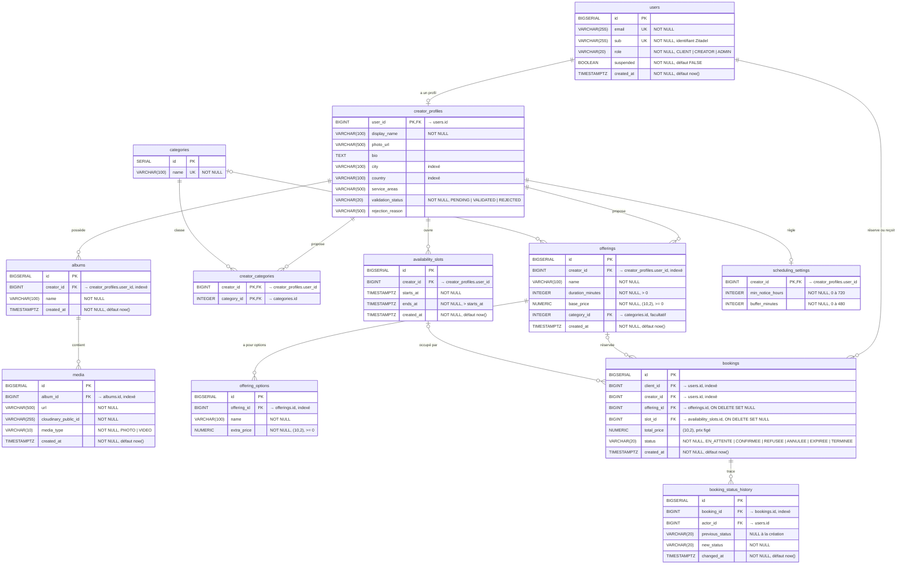

# Schéma physique de la base de données

Projet **Clic & Clap** — version **v0.2** (en cours : prestations)

La base est une **PostgreSQL 17** unique, partagée par tous les modules du monolithe. Les tables sont créées au démarrage de l'application par [`schema.sql`](../../backend/src/main/resources/schema.sql) (`spring.sql.init.mode=always`, instructions `CREATE … IF NOT EXISTS`) et lues ou écrites avec `JdbcClient`, en SQL explicite et paramétré.

Chaque table appartient à **un seul module**. Seul ce module y accède directement ; les autres passent par son API publique.

> Ce schéma décrit exactement `schema.sql`. Il est mis à jour à chaque release qui ajoute ou modifie des tables.

---

## Diagramme

**Légende** : `PK` clé primaire, `FK` clé étrangère, `UK` contrainte d'unicité. `||--o|` : un vers zéro ou un ; `||--o{` : un vers zéro ou plusieurs.

---

## Tables

### `users` — module `users`

Un compte de la plateforme, quel que soit son rôle.

| Colonne | Type | Contraintes |
|---------|------|-------------|
| `id` | `BIGSERIAL` | clé primaire |
| `email` | `VARCHAR(255)` | `NOT NULL`, `UNIQUE` |
| `sub` | `VARCHAR(255)` | `NOT NULL`, `UNIQUE` |
| `role` | `VARCHAR(20)` | `NOT NULL`, `CHECK (role IN ('CLIENT', 'CREATOR', 'ADMIN'))` |
| `suspended` | `BOOLEAN` | `NOT NULL`, défaut `FALSE` |
| `created_at` | `TIMESTAMPTZ` | `NOT NULL`, défaut `now()` |

> L'authentification est déléguée à Zitadel : aucun mot de passe n'est stocké dans notre base. Un compte est identifié par `sub`, l'identifiant du compte chez Zitadel (claim `sub` du token). Les autres modules obtiennent l'`id` d'un utilisateur à partir de son `sub` avec `UserApi.findIdBySub`.

### `categories` — module `catalog`

Les types de prestation utilisés par les filtres de la galerie (mariage, sport, clip…).

| Colonne | Type | Contraintes |
|---------|------|-------------|
| `id` | `SERIAL` | clé primaire |
| `name` | `VARCHAR(100)` | `NOT NULL`, `UNIQUE` |

### `creator_profiles` — module `creators`

Le profil d'un utilisateur au rôle `CREATOR`. La clé primaire est aussi la clé étrangère vers `users` : un compte a au plus un profil créateur.

| Colonne | Type | Contraintes |
|---------|------|-------------|
| `user_id` | `BIGINT` | clé primaire, `REFERENCES users (id) ON DELETE CASCADE` |
| `display_name` | `VARCHAR(100)` | `NOT NULL` |
| `photo_url` | `VARCHAR(500)` | — |
| `bio` | `TEXT` | — |
| `city` | `VARCHAR(100)` | index `idx_creator_profiles_city`, et index d'expression `idx_creator_profiles_city_normalisee` sur `lower(trim(city))` (filtre de la galerie) |
| `country` | `VARCHAR(100)` | index `idx_creator_profiles_country`, et index d'expression `idx_creator_profiles_country_normalisee` sur `lower(trim(country))` (filtre de la galerie) |
| `service_areas` | `VARCHAR(500)` | — |
| `validation_status` | `VARCHAR(20)` | `NOT NULL`, défaut `'VALIDATED'`, `CHECK (validation_status IN ('PENDING', 'VALIDATED', 'REJECTED'))` |
| `rejection_reason` | `VARCHAR(500)` | — |

> `validation_status` vaut `VALIDATED` par défaut en v0.1 (activation automatique). La validation par l'administrateur arrive en v0.2.

### `creator_categories` — module `creators`

Table d'association : les types de prestation proposés par chaque créateur (relation plusieurs-à-plusieurs).

| Colonne | Type | Contraintes |
|---------|------|-------------|
| `creator_id` | `BIGINT` | `NOT NULL`, `REFERENCES creator_profiles (user_id) ON DELETE CASCADE` |
| `category_id` | `INTEGER` | `NOT NULL`, `REFERENCES categories (id) ON DELETE CASCADE` |

Clé primaire composée : `(creator_id, category_id)`.

### `albums` — module `creators`

Les albums photo d'un créateur.

| Colonne | Type | Contraintes |
|---------|------|-------------|
| `id` | `BIGSERIAL` | clé primaire |
| `creator_id` | `BIGINT` | `NOT NULL`, `REFERENCES creator_profiles (user_id) ON DELETE CASCADE`, index `idx_albums_creator` |
| `name` | `VARCHAR(100)` | `NOT NULL` |
| `created_at` | `TIMESTAMPTZ` | `NOT NULL`, défaut `now()` |

### `media` — module `creators`

Les photos (et plus tard les vidéos) d'un album. Le fichier est stocké sur Cloudinary ; la base garde son URL et son identifiant Cloudinary.

| Colonne | Type | Contraintes |
|---------|------|-------------|
| `id` | `BIGSERIAL` | clé primaire |
| `album_id` | `BIGINT` | `NOT NULL`, `REFERENCES albums (id) ON DELETE CASCADE`, index `idx_media_album` |
| `url` | `VARCHAR(500)` | `NOT NULL` |
| `cloudinary_public_id` | `VARCHAR(255)` | `NOT NULL` |
| `media_type` | `VARCHAR(10)` | `NOT NULL`, défaut `'PHOTO'`, `CHECK (media_type IN ('PHOTO', 'VIDEO'))` |
| `created_at` | `TIMESTAMPTZ` | `NOT NULL`, défaut `now()` |

### `offerings` — module `offerings`

Les prestations à prix fixe d'un créateur (#27) : nom, durée et prix de base, affichées sur son profil public.

| Colonne | Type | Contraintes |
|---------|------|-------------|
| `id` | `BIGSERIAL` | clé primaire |
| `creator_id` | `BIGINT` | `NOT NULL`, `REFERENCES creator_profiles (user_id) ON DELETE CASCADE`, index `idx_offerings_creator` |
| `name` | `VARCHAR(100)` | `NOT NULL` |
| `duration_minutes` | `INTEGER` | `NOT NULL`, `CHECK (duration_minutes > 0)` |
| `base_price` | `NUMERIC(10,2)` | `NOT NULL`, `CHECK (base_price >= 0)`, en euros |
| `category_id` | `INTEGER` | facultatif, `REFERENCES categories (id) ON DELETE SET NULL` (#123, ajoutée par `ALTER TABLE … ADD COLUMN IF NOT EXISTS`) |
| `created_at` | `TIMESTAMPTZ` | `NOT NULL`, défaut `now()` |

### `offering_options` — module `offerings`

Les options payantes d'une prestation (ex. drone, retouches avancées), chacune avec son supplément.

| Colonne | Type | Contraintes |
|---------|------|-------------|
| `id` | `BIGSERIAL` | clé primaire |
| `offering_id` | `BIGINT` | `NOT NULL`, `REFERENCES offerings (id) ON DELETE CASCADE`, index `idx_offering_options_offering` |
| `name` | `VARCHAR(100)` | `NOT NULL` |
| `extra_price` | `NUMERIC(10,2)` | `NOT NULL`, `CHECK (extra_price >= 0)`, en euros |

### `availability_slots` — module `offerings`

Les créneaux libres d'un créateur (#28). Les heures sont stockées en `TIMESTAMPTZ`, saisies et affichées à l'heure de Bruxelles. Le module `bookings` les référence par `availability_slots.id` (`slot_id`).

| Colonne | Type | Contraintes |
|---------|------|-------------|
| `id` | `BIGSERIAL` | clé primaire |
| `creator_id` | `BIGINT` | `NOT NULL`, `REFERENCES creator_profiles (user_id) ON DELETE CASCADE`, index `idx_availability_slots_creator (creator_id, starts_at)` |
| `starts_at` | `TIMESTAMPTZ` | `NOT NULL` |
| `ends_at` | `TIMESTAMPTZ` | `NOT NULL`, `CHECK (ends_at > starts_at)` |
| `created_at` | `TIMESTAMPTZ` | `NOT NULL`, défaut `now()` |

### `scheduling_settings` — module `offerings`

Le préavis minimum et la marge entre deux rendez-vous d'un créateur (#28). Sans ligne, les deux valent 0.

| Colonne | Type | Contraintes |
|---------|------|-------------|
| `creator_id` | `BIGINT` | clé primaire, `REFERENCES creator_profiles (user_id) ON DELETE CASCADE` |
| `min_notice_hours` | `INTEGER` | `NOT NULL`, défaut 0, `CHECK (min_notice_hours BETWEEN 0 AND 720)` |
| `buffer_minutes` | `INTEGER` | `NOT NULL`, défaut 0, `CHECK (buffer_minutes BETWEEN 0 AND 480)` |

### `bookings` — module `bookings`

Les demandes de réservation d'un client pour une prestation et un créneau d'un créateur (#29). Le prix total est figé au moment de la réservation : modifier la prestation ensuite ne change pas une réservation existante.

| Colonne | Type | Contraintes |
|---------|------|-------------|
| `id` | `BIGSERIAL` | clé primaire |
| `client_id` | `BIGINT` | `NOT NULL`, `REFERENCES users (id) ON DELETE CASCADE`, index `idx_bookings_client` |
| `creator_id` | `BIGINT` | `NOT NULL`, `REFERENCES users (id) ON DELETE CASCADE`, index `idx_bookings_creator` |
| `offering_id` | `BIGINT` | toujours renseigné à la création (#29) ; `REFERENCES offerings (id) ON DELETE SET NULL` (contrainte `bookings_offering_id_fkey`, #133) |
| `slot_id` | `BIGINT` | toujours renseigné à la création (#29) ; `REFERENCES availability_slots (id) ON DELETE SET NULL` (contrainte `bookings_slot_id_fkey`, #133) ; index unique partiel `uq_bookings_slot_active (slot_id) WHERE status IN ('EN_ATTENTE', 'CONFIRMEE')` : anti-collision, une seule réservation active à la fois sur un créneau, qu'elle le devienne à la création ou à la confirmation (#30) |
| `total_price` | `NUMERIC(10,2)` | prix de base + options choisies, figé à la création (#29) |
| `status` | `VARCHAR(20)` | `NOT NULL`, défaut `'EN_ATTENTE'`, `CHECK (status IN ('EN_ATTENTE', 'CONFIRMEE', 'REFUSEE', 'ANNULEE', 'EXPIREE', 'TERMINEE'))` |
| `created_at` | `TIMESTAMPTZ` | `NOT NULL`, défaut `now()` |

`ON DELETE SET NULL` : supprimer une prestation ou un créneau garde les réservations passées (refusées, annulées, expirées, terminées), avec leur prix figé — c'est pourquoi `offering_id`/`slot_id` restent nullables même si #29 les renseigne toujours à la création. Les deux contraintes sont recréées à chaque démarrage par un `ALTER TABLE … DROP CONSTRAINT IF EXISTS …, ADD CONSTRAINT …`, pour corriger une table créée avant #133.

### `booking_status_history` — module `bookings`

Le journal des changements de statut (#39) : une ligne par transition réussie, jamais modifiée.

| Colonne | Type | Contraintes |
|---------|------|-------------|
| `id` | `BIGSERIAL` | clé primaire |
| `booking_id` | `BIGINT` | `NOT NULL`, `REFERENCES bookings (id) ON DELETE CASCADE`, index `idx_booking_status_history_booking` |
| `actor_id` | `BIGINT` | `NOT NULL`, `REFERENCES users (id)` |
| `previous_status` | `VARCHAR(20)` | `NULL` pour la création ; mêmes valeurs que `bookings.status` |
| `new_status` | `VARCHAR(20)` | `NOT NULL` ; mêmes valeurs que `bookings.status` |
| `changed_at` | `TIMESTAMPTZ` | `NOT NULL`, défaut `now()` |

### Suppressions en cascade

Supprimer un compte supprime son profil créateur, puis ses albums, puis leurs médias, ainsi que ses associations de catégories et ses prestations avec leurs options. Supprimer une catégorie supprime seulement ses associations avec les créateurs, et retire la catégorie des prestations qui l'utilisaient. Supprimer une prestation ou un créneau retire la référence des réservations qui les utilisaient (`SET NULL`), sans les supprimer.

---

## Données de départ

[`data.sql`](../../backend/src/main/resources/data.sql) insère 6 catégories au démarrage (`ON CONFLICT (name) DO NOTHING`, donc sans doublon) : Mariage, Événementiel, Sport, Produit, Clip, Portrait.

---

## Tables prévues dans les prochaines releases

Elles seront ajoutées à `schema.sql`, puis à ce document, au fil des releases :

| Release | Module | Données |
|---------|--------|---------|
| v0.3 | `bookings` | Réservations multiples (packs) |
| v0.3 | `reputation` | Avis et notes |
| v0.3 – v1.0 | `moderation` | Signalements d'avis et de médias |
