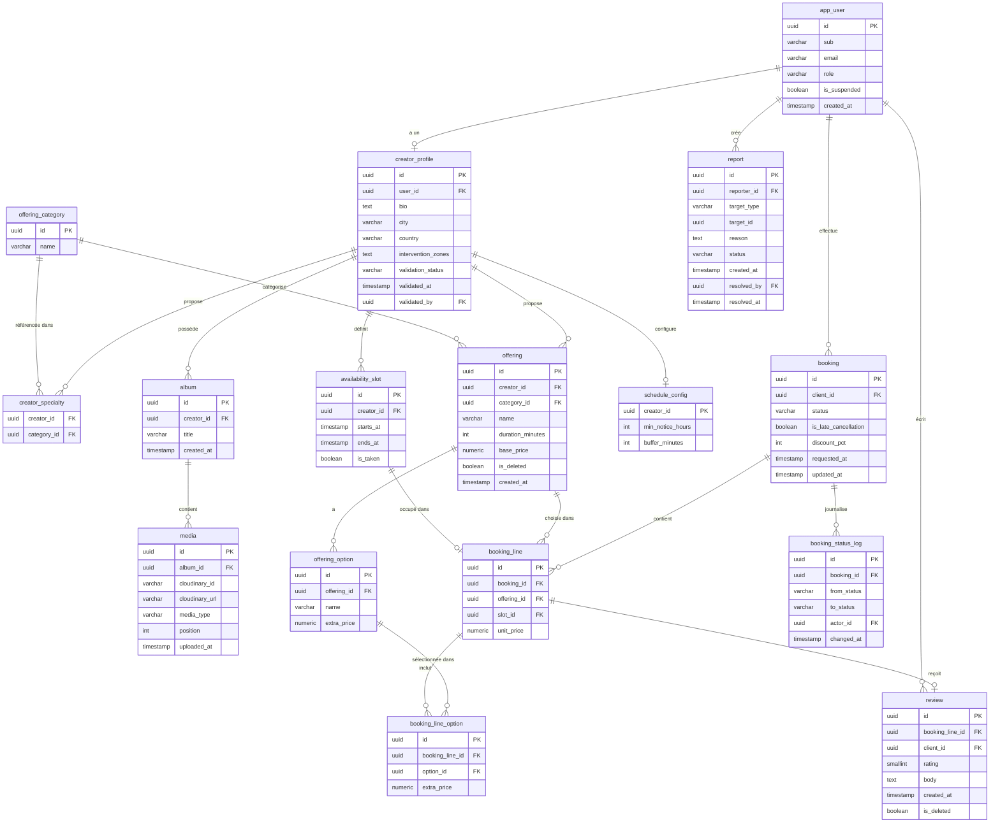

# Schéma physique de la base de données

**Projet** : Clic & Clap — SGBD : PostgreSQL
**Version** : 1.0 — Octobre 2026

---

## Résumé par module

| Module | Tables propres |
|--------|----------------|
| `users` | `app_user` |
| `creators` | `creator_profile`, `creator_specialty`, `album`, `media` |
| `offerings` | `offering_category`, `offering`, `offering_option`, `availability_slot`, `schedule_config` |
| `bookings` | `booking`, `booking_line`, `booking_line_option`, `booking_status_log` |
| `reputation` | `review` |
| `moderation` | `report` |
| `catalog`, `admin`, `notifications` | — (aucune table propre ; lecture sur les tables ci-dessus via `JdbcClient`) |

---

## Diagramme ER

---

## Contraintes notables

| Table | Contrainte | Effet |
|-------|------------|-------|
| `app_user` | `UNIQUE (sub)` | Un seul compte par identité Zitadel |
| `app_user` | `UNIQUE (email)` | Pas de doublon d'e-mail |
| `offering_category` | `UNIQUE (name)` | Pas de catégorie en double |
| `creator_specialty` | `PRIMARY KEY (creator_id, category_id)` | Pas de spécialité dupliquée |
| `booking_line` | `UNIQUE (slot_id)` | **Anti-collision** : un créneau ne peut figurer que dans une seule ligne de réservation |
| `review` | `UNIQUE (booking_line_id)` | Un seul avis par prestation réservée |
| `review` | `CHECK (rating BETWEEN 1 AND 5)` | Note comprise entre 1 et 5 |
| `offering` | `CHECK (base_price > 0)` | Prix strictement positif |
| `availability_slot` | `CHECK (ends_at > starts_at)` | Créneau temporellement cohérent |
| `booking` | `CHECK (discount_pct IN (0, 5, 10))` | Seules les paliers de promo autorisés |

---

## Valeurs autorisées (colonnes `status` / `role` / `type`)

| Table.colonne | Valeurs |
|---------------|---------|
| `app_user.role` | `CLIENT`, `CREATOR`, `ADMIN` |
| `creator_profile.validation_status` | `PENDING`, `ACTIVE`, `REJECTED`, `SUSPENDED` |
| `media.media_type` | `PHOTO`, `VIDEO` |
| `booking.status` | `PENDING`, `CONFIRMED`, `REFUSED`, `CANCELLED`, `EXPIRED`, `DONE` |
| `report.target_type` | `REVIEW`, `MEDIA` |
| `report.status` | `PENDING`, `REMOVED`, `DISMISSED` |

---

## Notes d'implémentation

- **Identifiants** : tous les `id` sont des `UUID` générés côté application (`UUID.randomUUID()`).
- **Prix** : `base_price`, `extra_price` et `unit_price` sont stockés en `NUMERIC(10, 2)` pour éviter les erreurs d'arrondi des flottants.
- **Snapshots de prix** : `booking_line.unit_price` et `booking_line_option.extra_price` capturent le prix **au moment de la réservation**. Si le créateur modifie une prestation, les réservations existantes conservent le prix initial.
- **Anti-collision** : le `UNIQUE (slot_id)` sur `booking_line` empêche deux confirmations simultanées du même créneau au niveau base de données. La logique applicative effectue en plus une vérification en transaction avant insertion (optimistic locking).
- **Polymorphisme** : `report.target_id` est un UUID pouvant pointer vers `review.id` ou `media.id` selon `report.target_type`. Pas de FK de base de données sur ce champ ; la cohérence est assurée par le module `moderation`.
- **Statuts** : modélisés en `VARCHAR` + contrainte `CHECK` ; migration vers des types `ENUM` PostgreSQL possible à l'initialisation du schéma Flyway.
- **`schedule_config`** : `creator_id` est à la fois PK et FK vers `creator_profile.id` — relation 1:1 avec table séparée pour ne pas surcharger `creator_profile`.
- **`booking_status_log.actor_id`** : FK vers `app_user.id` — enregistre qui a déclenché la transition (client, créateur ou scheduler système).
- **`report.resolved_by`** : nullable — null si le signalement n'est pas encore traité.

---

## Journal des modifications

| Date | Version | Modification |
|------|---------|--------------|
| 2026-10-12 | 1.0 | Création initiale — 16 tables couvrant les 6 modules avec données propres |
