# Wireframes

## Liste des écrans

| # | Écran | Profil | Responsable | Release |
|---|-------|--------|-------------|---------|
| 01 | Accueil / Galerie publique | Visiteur | Francisco | v0.1 |
| 02 | Connexion | Visiteur | Gedeon | v0.1 |
| 03 | Inscription | Visiteur | Gedeon | v0.1 |
| 04 | Profil public d'un créateur | Visiteur / Client | Francisco | v0.1 |
| 05 | Réservation d'un créneau | Client | Gedeon | v0.2 |
| 06 | Réservation multiple (pack) | Client | Gedeon | v0.3 |
| 07 | Prestations et agenda | Créateur | Francisco | v0.2 |
| 08 | Tableau de bord créateur | Créateur | Francisco | v0.2 |
| 09 | Mes réservations (et avis) | Client | Gedeon | v0.2 / v0.3 |
| 10 | Gestion des albums | Créateur | Francisco | v0.1 |
| 11 | Back-office administrateur | Administrateur | Francisco | v0.2 / v1.0 |
| 12 | Mon profil créateur (après inscription) | Créateur | Francisco | v0.1 |

## Navigation par rôle

- **Visiteur** : Galerie (01) → Profil public (04) → Inscription (03) / Connexion (02)
- **Client** : Galerie (01) → Profil public (04) → Réservation simple (05) ou pack (06) → Mes réservations et avis (09)
- **Créateur** : Inscription (03) → Mon profil (12) → Tableau de bord (08) → Prestations et agenda (07) → Albums (10)
- **Administrateur** : Back-office (11) : validation des créateurs, signalements, catégories, comptes

## Écrans

### 01 · Accueil / Galerie publique
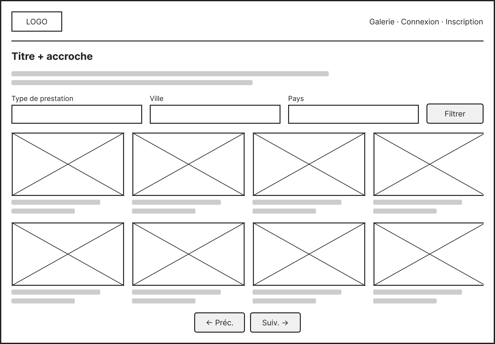

### 02 · Connexion
L'authentification est déléguée à **Zitadel** : le bouton « Se connecter » redirige vers la page de connexion Zitadel (e-mail et mot de passe, ou compte Google en bonus). Clic & Clap ne saisit ni ne stocke aucun mot de passe.

Après la connexion, Zitadel renvoie un token. Le backend vérifie sa signature, puis utilise son identifiant (`sub`) pour retrouver l'utilisateur.

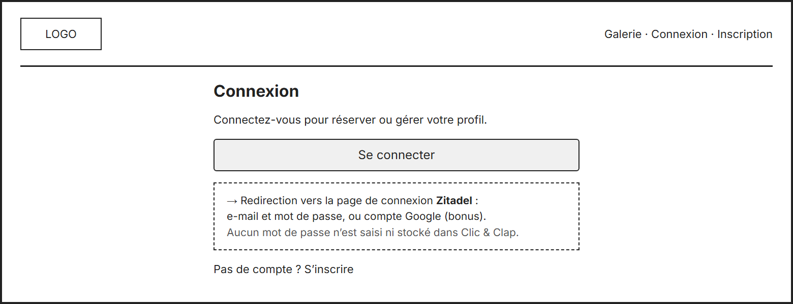

### 03 · Inscription
Le visiteur choisit d'abord son rôle (**client** ou **créateur**) dans Clic & Clap, puis « Continuer » le redirige vers la page d'inscription Zitadel. Le rôle choisi est enregistré dans son compte.

Après l'inscription : un client est redirigé vers la galerie (01), un créateur vers « Mon profil » (12).

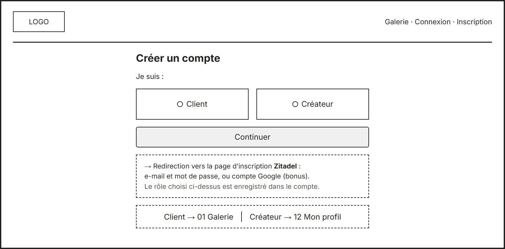

### 04 · Profil public d'un créateur
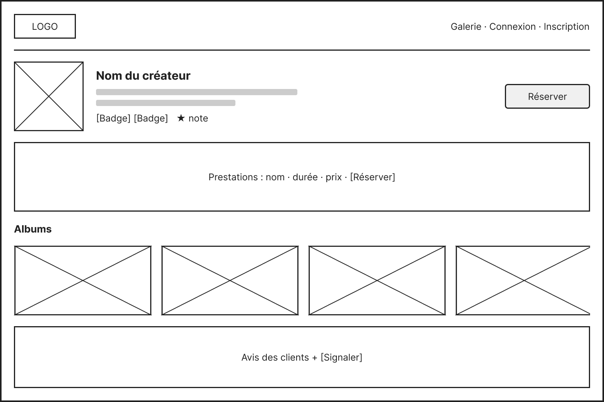

### 05 · Réservation d'un créneau
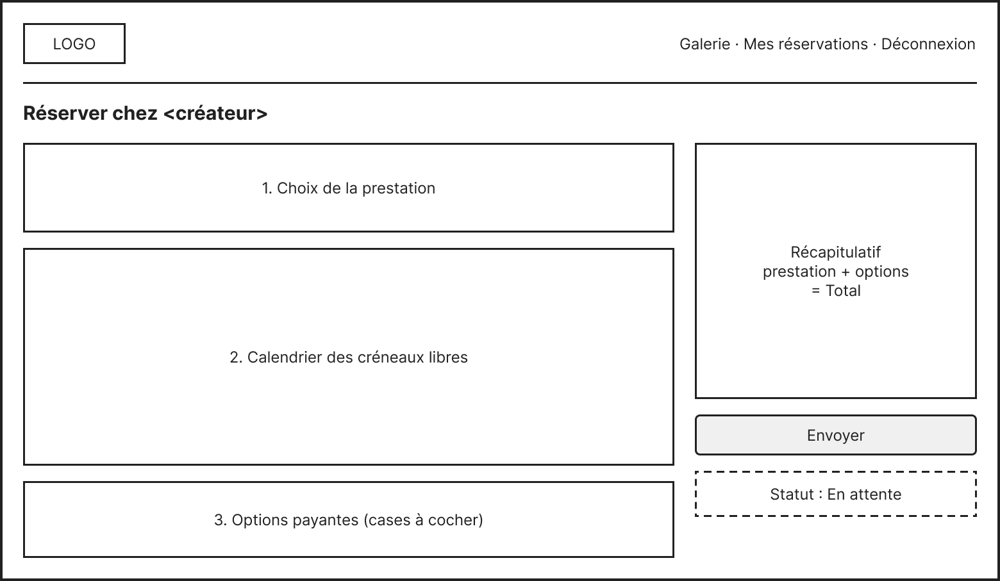

### 06 · Réservation multiple (pack)
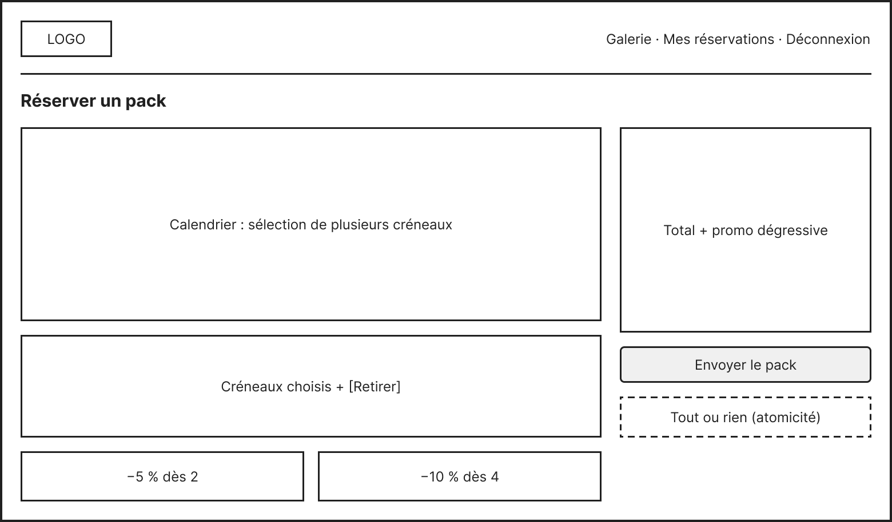

### 07 · Prestations et agenda
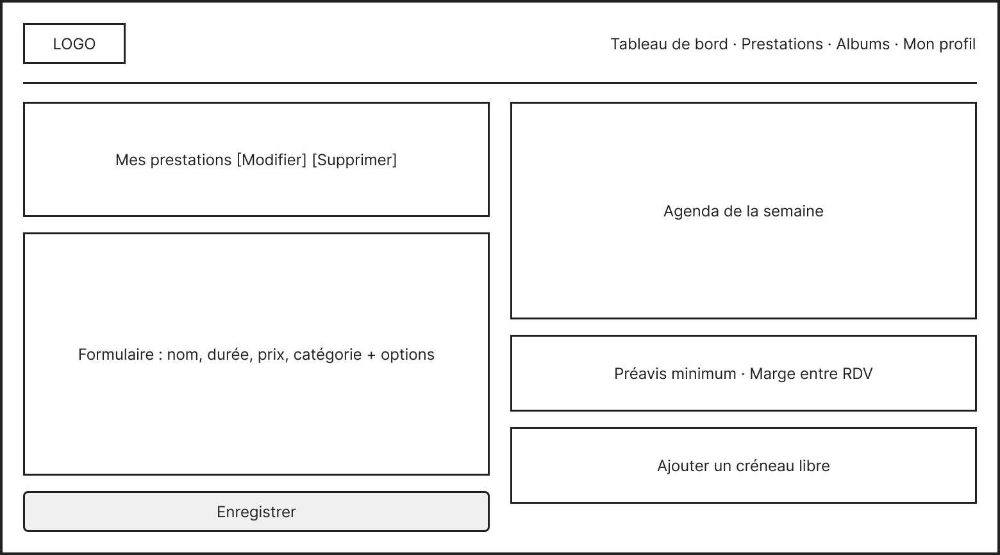

### 08 · Tableau de bord créateur
Le bandeau en pointillés n'apparaît que si le compte n'est pas encore validé (à partir de la v0.2).

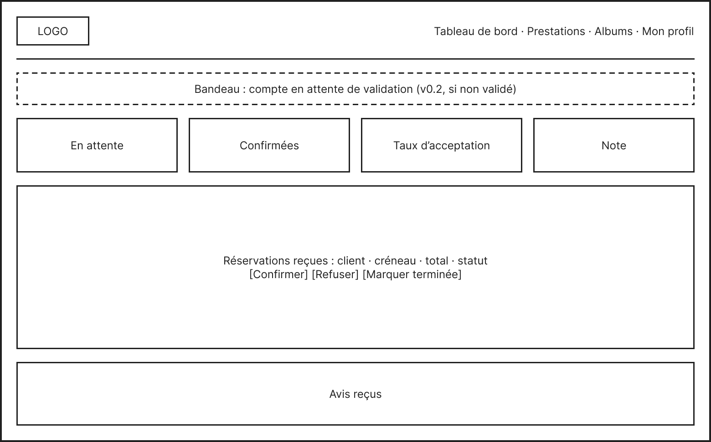

### 09 · Mes réservations (client)
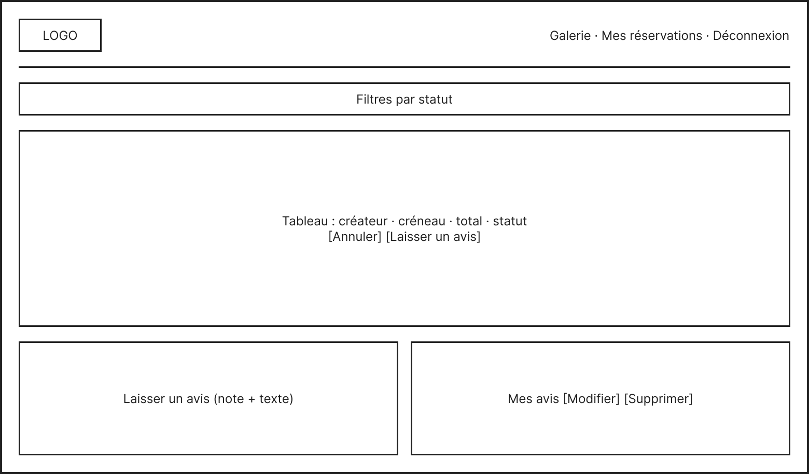

### 10 · Gestion des albums
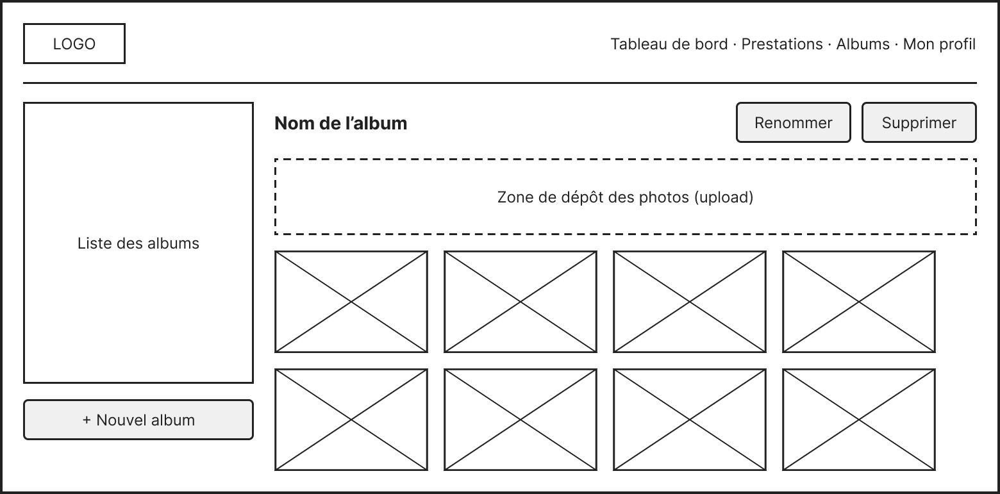

### 11 · Back-office administrateur
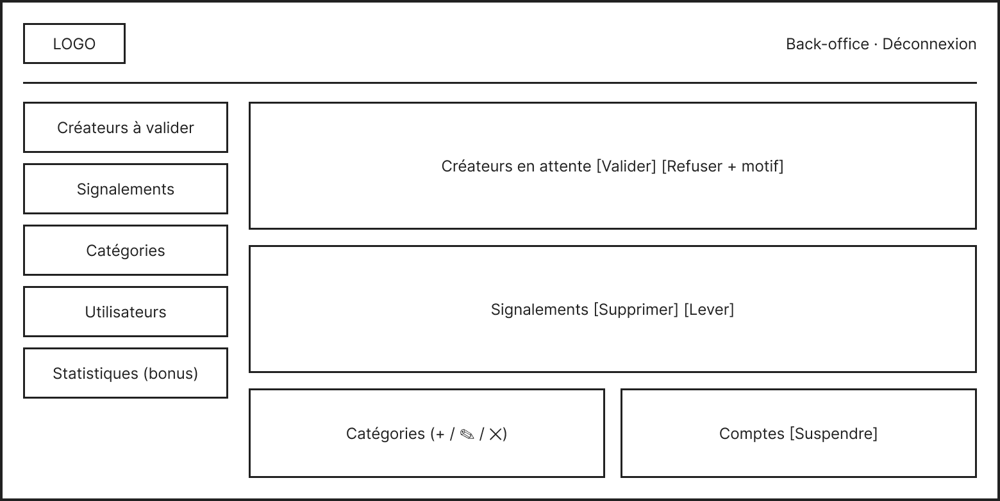

### 12 · Mon profil créateur
Page affichée juste après l'inscription d'un créateur, puis accessible via « Mon profil ».

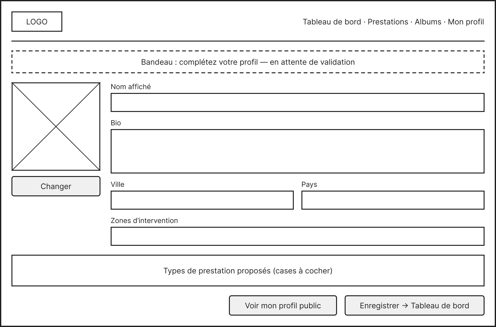